# AuthGuard Pay
## Human-Governed AI Evidence Review with PayPal Sandbox

**AuthGuard Pay is an AI-assisted, human-governed evidence-review system integrated with PayPal Sandbox for synthetic payment demonstration.** It evaluates prior-authorization cases using deterministic rules, local policy RAG, XGBoost risk scoring, and an explanation-only evidence review panel. A named human explicitly approves a fixed synthetic patient-pay amount. PayPal Sandbox integration demonstrates auditable, human-controlled order creation, buyer approval, and payment capture—never autonomous decision-making or real financial transactions.

**Synthetic demonstration only.** All cases, amounts, approval workflows, and payments are demonstrations using Sandbox credentials. This system does not determine insurance coverage, provide clinical advice, submit real authorization requests, perform real patient transactions, or replace qualified healthcare professionals.

---

## Project Links

- **Live Demo:** https://healthcareaiother-production.up.railway.app/authguard
- **GitHub Repository:** https://github.com/draculess99/AuthGuard-AI/
- **LinkedIn:** https://www.linkedin.com/in/gammaconsult/
- **Portfolio:** https://draculess99.github.io/

---

## Why PayPal + AI

**Deterministic routing locks first.** Deterministic expert rules, XGBoost risk scoring, and guardrails establish and lock the workflow route before any explanation is generated. Policy RAG and the Evidence Review Panel run afterward, for explanation and critique only.

**Evidence review panel explains only.** Specialist critique and optional Groq/Gemini rephrasing are advisory explanation layers. They cannot alter the locked route, human-review requirement, or synthetic patient-pay amount.

**Named human controls everything.** A qualified reviewer explicitly approves the fixed synthetic patient-pay amount. PayPal Sandbox creates an order, obtains buyer approval in Sandbox, and captures payment only after explicit human action—never automatically.

**Timestamped audit trail.** All approvals, order creations, and payment captures are recorded with timestamps in the application audit log. The log is a demonstration of structured decision traceability.

---

## Core Workflow

1. **Case intake:** User or external data source provides structured authorization case (synthetic or external de-identified data).
2. **Deterministic route locked:** Deterministic expert rules, fixed XGBoost thresholds, and guardrails establish the workflow decision before explanation.
3. **Evidence review panel critique:** Specialist agents explain the locked route and provide critique (explanation and audit only; cannot alter routing).
4. **Optional LLM rephrasing:** Groq or Gemini may rephrase the canonical explanation if configured; output is validated and falls back to canonical if invalid.
5. **Named human review:** Qualified reviewer reads the locked route, panel findings, and optional explanation. They decide whether to approve the case for submission or request additional evidence.
6. **Payment approval (if demo):** Reviewer explicitly approves the fixed synthetic patient-pay amount via checkbox and action button, recorded in audit log.
7. **PayPal Sandbox (if approved):** Reviewer creates order, completes buyer approval in Sandbox, and captures payment. All actions are human initiated and timestamped.

---

## System Architecture

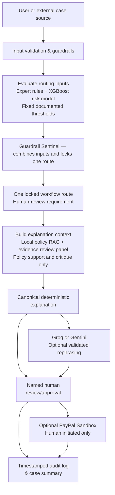

---

## PayPal Sandbox Workflow

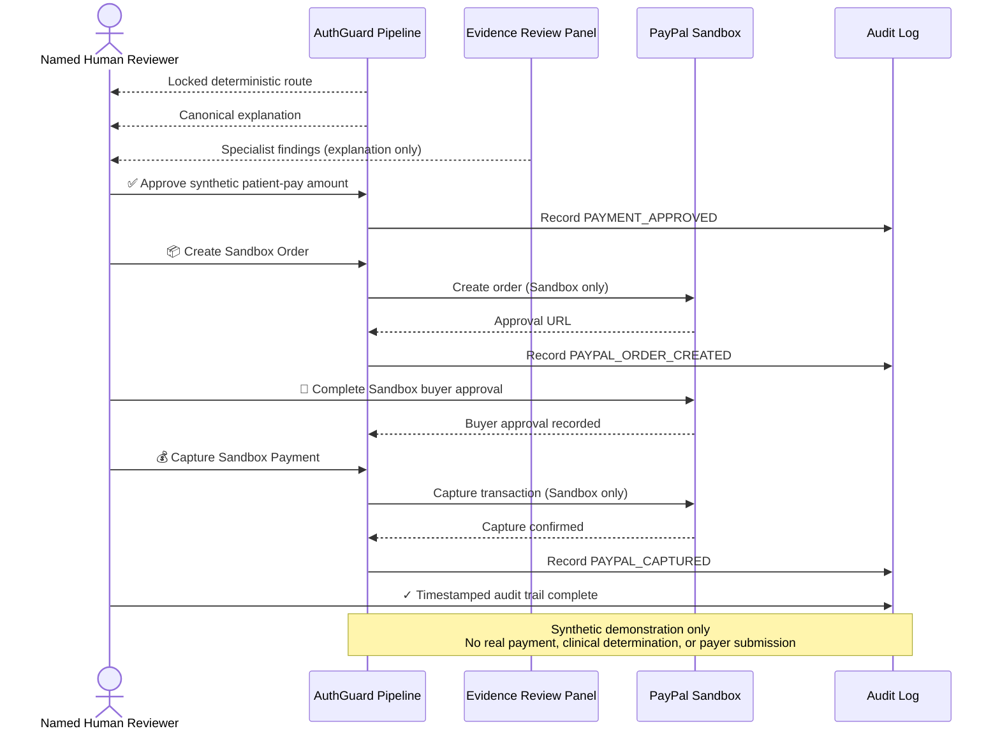

---

## Run from the PayPal Feature Branch

The PayPal Sandbox integration is available on the `feature/paypal-authguard` branch. Use these Windows PowerShell commands to clone, set up, and run the application:

### First-Time Setup

```powershell
git clone https://github.com/draculess99/AuthGuard-AI.git
cd AuthGuard-AI
git fetch origin
git switch feature/paypal-authguard
git pull --ff-only origin feature/paypal-authguard
python -m venv .venv
.\.venv\Scripts\Activate.ps1
python -m pip install --upgrade pip
pip install -r requirements.txt
Copy-Item .env.example .env
python app.py
```

**Important:**
- Edit `.env` to add your **PayPal Sandbox credentials** (`PAYPAL_CLIENT_ID`, `PAYPAL_CLIENT_SECRET`)
- Ensure `PAYPAL_MODE=sandbox` (never production)
- **Never use production PayPal credentials in development**
- Once the application starts, open the local URL printed to the console (typically `http://localhost:8501`)
- The Flask API and Streamlit dashboard are started together by `app.py`

### Testing

Run the complete test suite to verify the installation:

```powershell
python -m pytest -q
```

All 52 tests should pass, including PayPal Sandbox integration tests.

### Update an Existing Checkout

If you already have the repository cloned, update to the latest PayPal feature branch:

```powershell
git switch feature/paypal-authguard
git pull --ff-only origin feature/paypal-authguard
python -m pytest -q
python app.py
```

---

## Run Locally

### Prerequisites

- Python 3.9+
- Free PayPal Sandbox account (optional, for payment demo)

### Setup

1. **Clone and navigate:**
   ```bash
   git clone https://github.com/draculess99/AuthGuard-AI
   cd AuthGuard-AI
   ```

2. **Install dependencies:**
   ```bash
   pip install -r requirements.txt
   ```

3. **Configure .env (optional PayPal):**
   ```env
   PAYPAL_MODE=sandbox
   PAYPAL_CLIENT_ID=<your_sandbox_client_id>
   PAYPAL_CLIENT_SECRET=<your_sandbox_secret>
   AUTHGUARD_API_PORT=5008
   ```

   Obtain free Sandbox credentials at [developer.paypal.com](https://developer.paypal.com).

4. **Run the application:**
   ```bash
   python app.py
   ```

5. **Access:**
   - **Streamlit UI:** http://localhost:8501
   - **Flask API health:** http://localhost:5008/health

---

## Complete Local Demonstration Walkthrough

This walkthrough takes you from a clean start to a completed PayPal **Sandbox** payment, one step at a time. It uses only synthetic data. **No real money, patient, clinical decision, or coverage decision is involved.**

### How It Works (Plain Language)

1. **The route is decided first, and by fixed rules.** Expert rules and the XGBoost denial-risk model score the request. Fixed, documented thresholds and guardrails then lock one workflow route.
2. **Explanation comes after the route is locked.** Policy RAG (a lookup in the local policy notes) and the six-member Evidence Review Panel run only after the route is locked. They explain and challenge the result, but they **cannot change the deterministic route**.
3. **The Arbiter writes the canonical explanation.** It is a deterministic summary of the locked route and the panel findings. Optional Groq/Gemini text can only rephrase it.
4. **Memory and the audit log keep records.** Memory finds similar prior cases. The timestamped audit log records human decisions and payment actions.
5. **PayPal is Sandbox only.** A person must approve the synthetic payment before an order can be created, and a person must trigger the capture.

### Step-by-Step Demonstration

#### A. Switch to the correct branch and start the application

Open PowerShell in your AuthGuard-AI checkout. First-time setup is described in [Run from the PayPal Feature Branch](#run-from-the-paypal-feature-branch).

```powershell
git switch feature/paypal-authguard
git branch --show-current          # should print: feature/paypal-authguard
.\.venv\Scripts\Activate.ps1
python app.py
```

`app.py` starts both the Flask API (port 5008) and the Streamlit dashboard (port 8501). Leave this window open for the whole demo.

#### B. Open the dashboard

Go to **http://localhost:8501**. You should see the **AUTHGUARD AI PAYPAL** header, the intake form, and the Live Agent Pipeline.

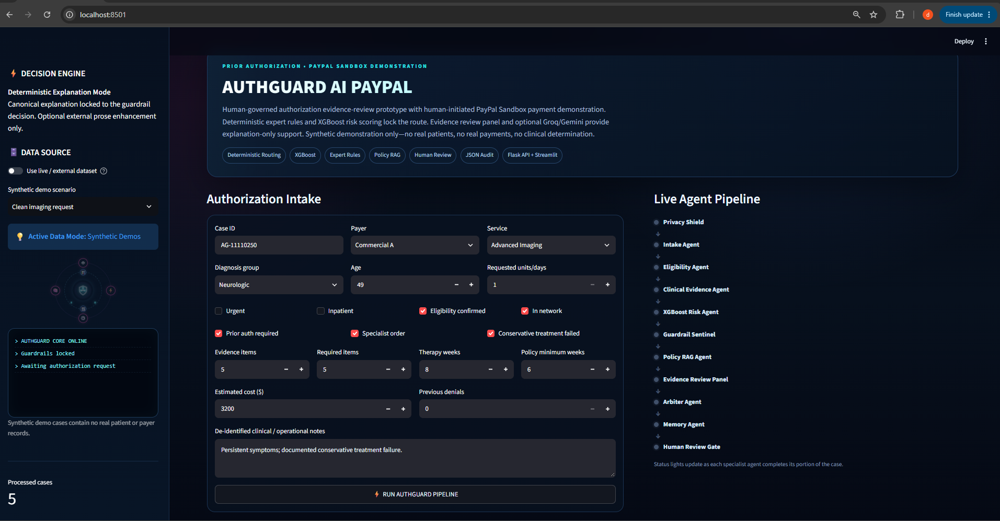

*The dashboard before a run. The left panel shows the active data mode and the pipeline stages wait on the right.*

#### C. Run the Clean imaging request

Keep **Synthetic Demos** selected (the **Use live / external dataset** switch stays off). The scenario **Clean imaging request** is selected by default. Click **RUN AUTHGUARD PIPELINE** and wait for "AuthGuard processing complete."

#### D. Read the result cards

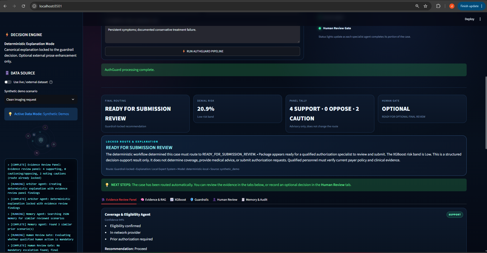

*Result of the Clean imaging request: the locked route, denial risk, panel tally, and human gate.*

| Card | What it means |
|---|---|
| **Final routing** | The guardrail-locked route. For the clean case this is `READY FOR SUBMISSION REVIEW`. |
| **Denial risk** | The XGBoost denial-risk score after rule adjustments, with its risk band (about 20.9%, Low, for the clean case). |
| **Panel tally** | How many of the six panel members said SUPPORT, OPPOSE, or CAUTION. The clean case shows **4 SUPPORT · 0 OPPOSE · 2 CAUTION**. This is advisory and does not change the route. |
| **Human gate** | Whether qualified human review is **REQUIRED** or **OPTIONAL**. The clean case shows OPTIONAL, but a specialist review is still recommended before any submission. |

#### E. Review the tabs

Click through each tab under the result cards:

| Tab | What to look at |
|---|---|
| **Evidence Review Panel** | One card per panel member with its stance, confidence, evidence, and recommendation. |
| **Evidence & RAG** | The local policy passages that were retrieved after the route was locked. |
| **XGBoost** | The denial-risk model output and the signals that influenced the score. |
| **Guardrails** | The non-negotiable controls and the reasons recorded for the locked route. |
| **Human Review** | Where the reviewer records a decision, and where the synthetic payment demo lives. |
| **Memory & Audit** | Similar prior cases and the recent audit records. |

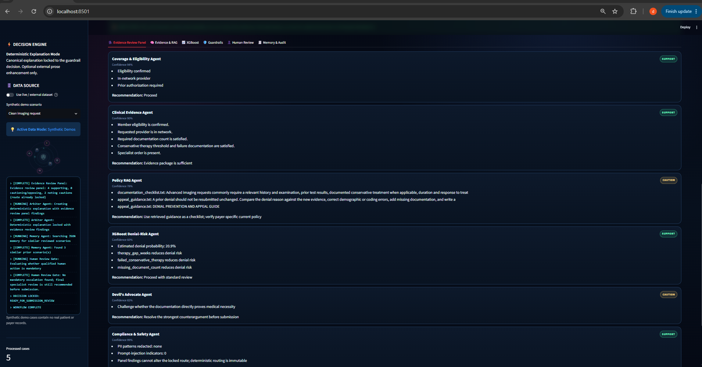

*The Evidence Review Panel: six findings that explain the locked route but cannot change it.*

#### F. Record a human review decision

1. Open the **Human Review** tab.
2. Enter a **reviewer name / role** (the default is fine) and a short **review rationale**.
3. Click **Approve package**. A green message confirms the decision was saved.

This records an **internal portfolio workflow action** in the audit log. It does **not** submit anything to a payer.

> **Streamlit rerun note:** every click makes Streamlit rerun the page, and it can jump back to the first tab. If that happens, click the **Human Review** tab again and confirm the green "Human decision saved" message is still showing, or check the audit table in step J.

#### G. Record the synthetic payment approval and create one Sandbox order

Scroll down in **Human Review** to **Synthetic Patient-Pay Demo**.

1. Confirm the page shows **PayPal Sandbox configured** and the synthetic amount (`$640.00` for the clean case).
2. **Step 1:** tick **I explicitly approve this synthetic patient-pay amount for PayPal Sandbox demo**, then click **Record Synthetic Payment Approval**.
3. **Step 2:** click **Create Sandbox Order** **once**. The order ID appears and an **Open PayPal Sandbox Approval** link is shown.

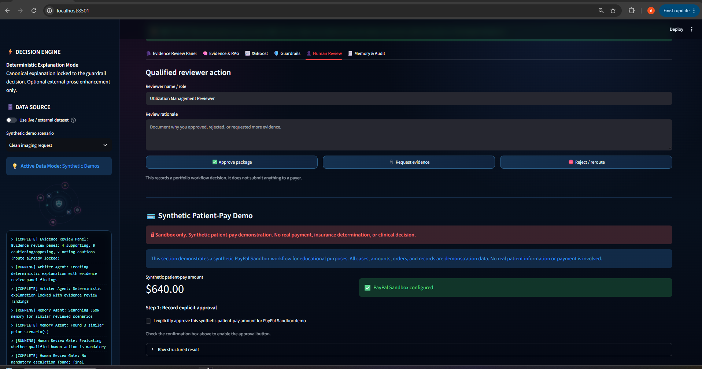

*Human Review with the Synthetic Patient-Pay Demo. The explicit approval checkbox comes before any order can be created.*

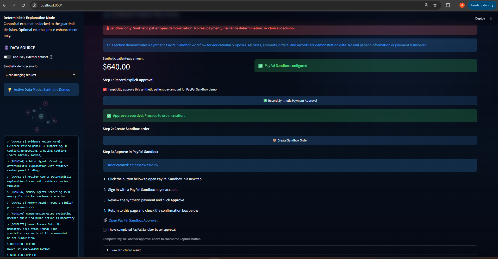

*After the approval is recorded and the order is created: the order ID and the link to PayPal Sandbox approval.*

The server will not create an order unless a matching `PAYMENT_APPROVED` record already exists for the same run and amount.

#### H. Approve the order in PayPal Sandbox

1. Click **Open PayPal Sandbox Approval**. It opens PayPal Sandbox in a new tab.
2. Sign in with a **PayPal Personal Sandbox buyer account** (created in your developer.paypal.com Sandbox accounts, never your real PayPal account).
3. Choose the simulated funding source that the Sandbox account provides.
4. Review the order and click **Pay Now** (or **Approve**).

**No real money moves.** Sandbox accounts, balances, and cards are simulated by PayPal.

#### I. Capture the payment

1. After approval, PayPal redirects to `localhost` (the return URL). Close that redirected tab and **go back to your original AuthGuard Streamlit tab**, so the pending order is not lost (see Troubleshooting).
2. Tick **I have completed PayPal Sandbox buyer approval**.
3. Click **Capture Sandbox Payment** **exactly once**. A green "Payment captured" message shows the capture ID.
4. The capture status is **COMPLETED**. You can see it in the `capture_status` column of the audit table in step J.

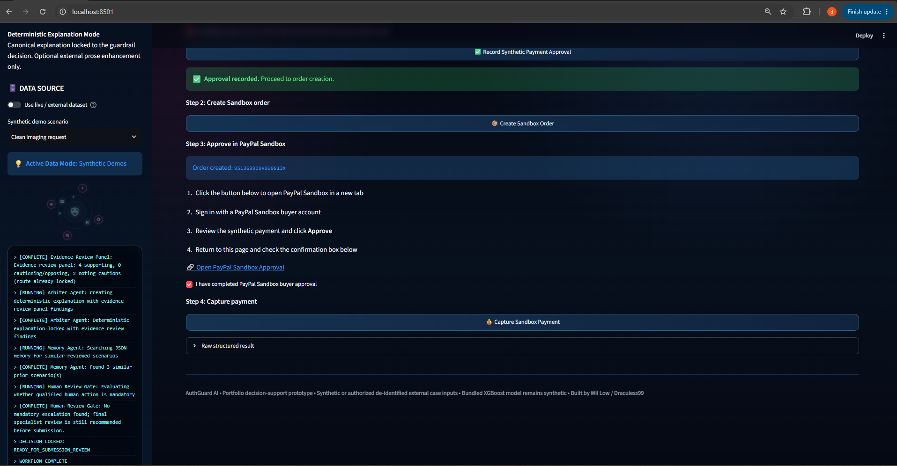

*Buyer approval confirmed and the Capture Sandbox Payment step enabled.*

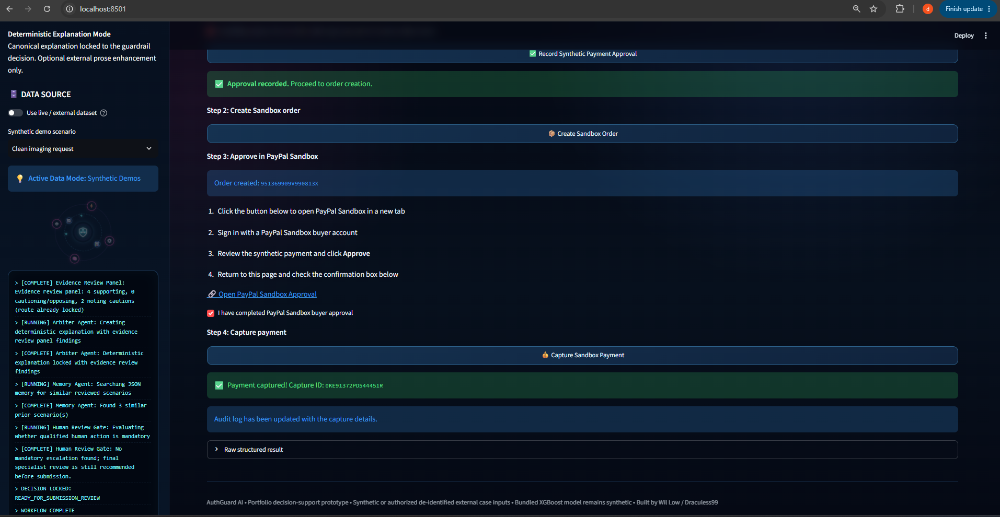

*The Sandbox payment captured, with the capture ID and the audit-log confirmation.*

#### J. Verify the audit trail

Open **Memory & Audit** and look at **Recent human-review audit**. For the run you just made, you should see these four actions:

| Action | Recorded when |
|---|---|
| `APPROVE_PACKAGE_FOR_SUBMISSION` | You clicked **Approve package** (step F). |
| `PAYMENT_APPROVED` | You recorded the synthetic payment approval (step G). |
| `PAYPAL_ORDER_CREATED` | The Sandbox order was created (step G). |
| `PAYPAL_CAPTURED` | The Sandbox payment was captured, with `capture_status` `COMPLETED` (step I). |

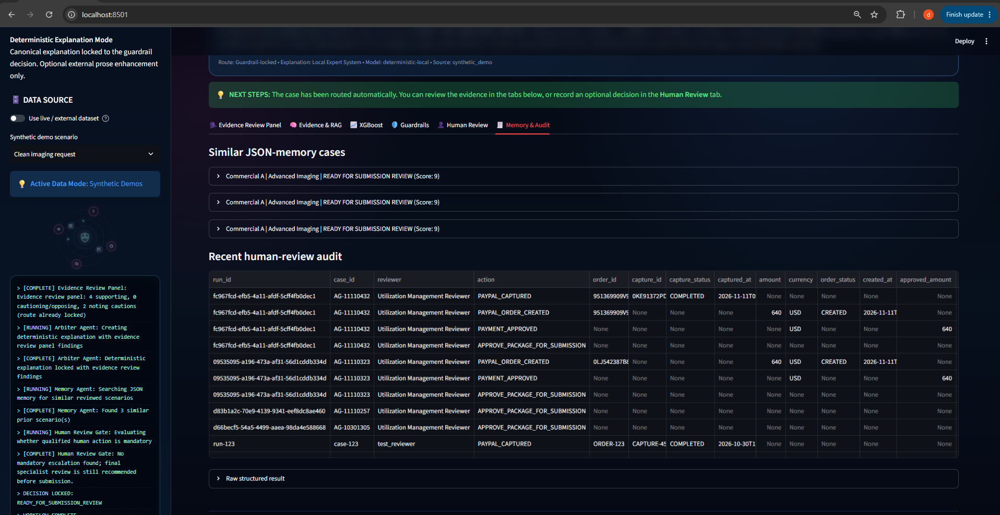

*Screenshot 8A — Full audit history:* Full Memory & Audit view showing current and earlier synthetic demonstration or test records.

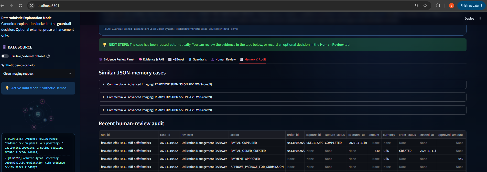

*Screenshot 8B — Current completed audit chain:* Close-up of the current run showing `APPROVE_PACKAGE_FOR_SUBMISSION`, `PAYMENT_APPROVED`, `PAYPAL_ORDER_CREATED`, and `PAYPAL_CAPTURED` with `COMPLETED` capture status.

**Screenshot 8B is the authoritative current-run evidence.** Screenshot 8A is the unfiltered table, so it also lists earlier synthetic demonstration and test records. The audit log is a timestamped application record for demonstration, not a tamper-proof ledger.

### Screenshot Guide

| File | Shows | Walkthrough step |
|---|---|---|
| `docs/images/paypal/01-authguard-pay-dashboard.png` | Dashboard and intake form before a run | B |
| `docs/images/paypal/02-evidence-review-result.png` | Locked route, denial risk, panel tally, human gate | D |
| `docs/images/paypal/03-agent-review-panel.png` | Six Evidence Review Panel cards | E |
| `docs/images/paypal/04-human-payment-approval.png` | Human Review and the Synthetic Patient-Pay Demo | F, G |
| `docs/images/paypal/05-paypal-sandbox-order.png` | Sandbox order created, approval link shown | G |
| `docs/images/paypal/06-paypal-sandbox-approval.png` | Buyer approval confirmed, capture enabled | H, I |
| `docs/images/paypal/07-payment-captured.png` | Capture confirmation and capture ID | I |
| `docs/images/paypal/08a-audit-trail-full-history.png` | Full Memory & Audit view, including earlier synthetic and test records | J |
| `docs/images/paypal/08b-audit-trail-current-run.png` | Current run's four audit actions (authoritative evidence) | J |

The walkthrough uses nine screenshots in total. Screenshots must never show credentials, secrets, or real personal information.

### Troubleshooting the Demo

- **Use a PayPal Personal Sandbox buyer.** Sign in only with a Sandbox buyer account from developer.paypal.com, never a real PayPal account.
- **Streamlit reruns on every interaction.** If the page jumps to another tab, reopen the relevant tab (for example **Human Review**) and check for the green saved message.
- **Do not create or capture the same order repeatedly.** Click **Create Sandbox Order** once and **Capture Sandbox Payment** once. A captured order cannot be captured again.
- **Keep the original Streamlit session while an order is pending.** The order ID is held in that browser tab's session. Reloading the page, or using the tab PayPal redirects to, starts a new session and the pending order will not be shown.
- **Check the Flask API.** Open **http://localhost:5008/health**. It should return `"status": "ok"`.
- **`PAYPAL_MODE` must be `sandbox`.** Any other value leaves PayPal unconfigured. The optional `PAYPAL_RETURN_URL` and `PAYPAL_CANCEL_URL` default to `http://localhost:8501`.
- **Never put credentials in README.md or screenshots.** Keep them in `.env`, which is ignored by Git.

---

## API Overview

### Health Check
```bash
curl http://localhost:5008/health
```

### Process a Case
```bash
POST /api/process
Content-Type: application/json

{
  "provider": "Local Expert System",
  "case": {
    "case_id": "DEMO-001",
    "payer": "Commercial A",
    "service_type": "Advanced Imaging",
    "diagnosis_group": "Neurologic",
    "age_years": 50,
    ...
  }
}
```

### Record Human Review Decision
```bash
POST /api/review
Content-Type: application/json

{
  "run_id": "<run_id>",
  "case_id": "DEMO-001",
  "reviewer": "Jane Doe",
  "action": "APPROVE_PACKAGE_FOR_SUBMISSION",
  "approved_amount": 640.00
}
```

### Create PayPal Sandbox Order
```bash
POST /api/paypal/create-order
Content-Type: application/json

{
  "run_id": "<run_id>",
  "case_id": "DEMO-001",
  "reviewer": "Jane Doe",
  "amount": 640.00
}
```

Response:
```json
{
  "status": "created",
  "order_id": "<paypal_order_id>",
  "amount": 640.00,
  "currency": "USD",
  "approval_url": "https://www.sandbox.paypal.com/checkoutnow?token=..."
}
```

### Capture PayPal Sandbox Order
```bash
POST /api/paypal/capture-order
Content-Type: application/json

{
  "order_id": "<paypal_order_id>",
  "run_id": "<run_id>",
  "case_id": "DEMO-001",
  "reviewer": "Jane Doe"
}
```

### Other Endpoints

- `GET /api/cases` — List processed cases
- `GET /api/memory` — Similar case summaries
- `GET /api/audit` — Human-review actions and PayPal transaction records
- `GET /api/model/metrics` — XGBoost model metrics
- `GET /api/knowledge` — Local policy RAG documents

---

## Pipeline Stages

The multi-agent orchestrator executes these deterministic stages in order:

1. **Privacy Shield** — Redacts PII patterns, detects prompt injection
2. **Intake Agent** — Normalizes case identifiers and metadata
3. **Eligibility Agent** — Checks member eligibility and network status
4. **Clinical Evidence Agent** — Applies deterministic evidence rules
5. **XGBoost Risk Agent** — Scores denial probability and risk band
6. **Guardrail Sentinel** — Locks the deterministic route *before* policy retrieval and panel generation
7. **Policy RAG Agent** — Retrieves relevant local policy guidance (explanation support only, after the lock)
8. **Evidence Review Panel** — Specialist critique and findings (explanation and audit only)
9. **Arbiter Agent** — Creates canonical deterministic explanation and optional Groq/Gemini rephrasing
10. **Memory Agent** — Finds similar cases for learning
11. **Human Review Gate** — Routes cases requiring qualified review

**Routing authority is deterministic.** The Evidence Review Panel provides expert critique and explanation, but cannot alter the locked workflow route or human-review requirements.

---

## Evidence Review Panel

The panel provides specialist perspectives on the already-locked route:

- **Coverage & Eligibility Agent** — Eligibility, network, and authorization findings
- **Clinical Evidence Agent** — Documentation completeness and rule results
- **Policy RAG Agent** — Relevant policy chunks and compliance guidance
- **XGBoost Denial-Risk Agent** — Denial probability, risk band, top risk factors
- **Devil's Advocate Agent** — Strongest counterarguments and evidence gaps
- **Compliance & Safety Agent** — Injection detection, PII redaction, governance flags

Each specialist reports stance (`SUPPORT`, `OPPOSE`, `CAUTION`), confidence score, and evidence. Panel findings are visible for audit and explanation. **They cannot alter the locked route.**

---

## Testing

```bash
pytest -q
```

The test suite covers:
- PII redaction and prompt-injection detection
- Deterministic rule evaluation
- Multi-agent pipeline execution
- XGBoost risk scoring
- Groq/Gemini model availability and fallback behavior
- PayPal Sandbox order creation and capture (mocked HTTP calls)
- Audit log recording
- Case and memory persistence

PayPal Sandbox calls are mocked in tests. Live Streamlit usage requires valid `PAYPAL_CLIENT_ID` and `PAYPAL_CLIENT_SECRET` in `.env`.

---

## Safety, Limitations, and Non-Goals

### What AuthGuard Pay Is
- An AI-assisted evidence review system demonstrating deterministic routing authority
- A Sandbox payment workflow showing human-controlled order, approval, and capture
- An educational prototype using synthetic data

### What AuthGuard Pay Is NOT
- A clinical diagnostic system
- An insurance/coverage determination engine
- A payer integration or real authorization submission system
- A real-payment processor (Sandbox only)
- An autonomous decision-making system (humans approve all actions)

### Audit Log
- All approvals, order creations, and payment captures are timestamped in the JSON audit log
- The audit log is a demonstration of structured decision traceability
- It is **not** cryptographically secured, immutable, or tamper-proof
- It is an application record suitable for demonstration and learning

### Evidence Review Panel
- Panel findings are advisory explanation layers
- Panel cannot alter the locked route or human-review requirements
- Panel cannot change the synthetic patient-pay amount
- Panel cannot create or capture PayPal orders

### External LLMs (Groq/Gemini)
- Optional presentation enhancements only
- Receive the locked route and panel findings
- May rephrase explanations for clarity
- Cannot alter routing, human-review requirements, or payment amount
- Output is validated; invalid output falls back to canonical explanation

---

## Project Structure

```
AuthGuard-Pay/
├── app.py                          # Entry point (Flask + Streamlit)
├── backend/
│   ├── agents/committee.py         # Pipeline orchestrator
│   ├── data_sources.py             # External case loading
│   ├── expert_system.py            # Deterministic rules
│   ├── guardrails.py               # Route locking logic
│   ├── llm_clients.py              # Groq/Gemini interface
│   ├── memory.py                   # JSON audit & memory store
│   ├── model.py                    # XGBoost denial-risk classifier
│   ├── paypal.py                   # PayPal Sandbox client
│   ├── rag.py                      # Local policy RAG
│   └── server.py                   # Flask API
├── frontend/
│   └── dashboard.py                # Streamlit UI
├── data/
│   └── knowledge/                  # Local policy documents
├── database/                       # JSON audit, cases, memory
├── models/                         # Serialized XGBoost model
├── tests/
│   ├── test_pipeline.py            # Pipeline, routing order, and dashboard tests
│   └── test_paypal.py              # PayPal integration tests
├── .env                            # Configuration (not in repo)
├── .env.example                    # Configuration template
├── requirements.txt                # Python dependencies
├── Procfile                        # Railway deployment
└── README.md                       # This file
```

---

## Summary

**AuthGuard Pay demonstrates deterministic AI-assisted evidence review with human-governed payment orchestration.**

A named human reviewer evaluates a locked, deterministic workflow route supported by specialist panel critique and optional LLM explanation. They explicitly approve a fixed synthetic patient-pay amount. PayPal Sandbox integration shows auditable, human-initiated order creation, buyer approval, and payment capture. All actions—evidence review, approval, payment—are timestamped and recorded. No agent or external LLM can approve a payment, create an order, capture a payment, change the amount, or override the locked route.

**Built by Wil Low (Draculess99)** as a synthetic demonstration and educational prototype.